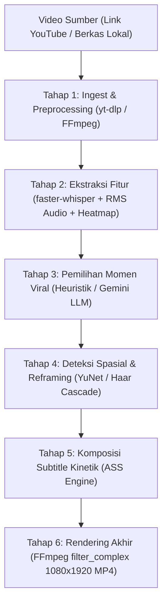

# LAPORAN AUDIT SISTEM & ARSITEKTUR TEKNOLOGI
## Proyek: CalClip.IN (AI Video Clipper & Kinetic Motion Generator)
*Dokumen Rujukan Akademik & Teknis untuk Penyusunan Skripsi / Tugas Akhir*

---

## 1. STRUKTUR FOLDER UTAMA PROYEK

Struktur direktori utama proyek setelah mengabaikan direktori dependensi dan artefak build (`node_modules/`, `dist/`, `.venv/`, `build/`, `.git/`):

```text
callclip/
├── index.html                         # Entry-point HTML web application
├── package.json                       # Konfigurasi dependensi Node.js / Frontend
├── tsconfig.json                      # Konfigurasi TypeScript compiler
├── vite.config.ts                     # Konfigurasi bundler Vite & API Proxy (port 5173 -> 8799)
├── tailwind.config.js                 # Konfigurasi styling Tailwind CSS
├── postcss.config.js                  # Konfigurasi PostCSS
├── jalankan-calclip.bat               # Skrip startup terpadu Windows (Backend + Frontend)
├── jalankan-studio.bat                # Skrip startup backend server Python
│
├── alat/                              # CORE BACKEND & PIPELINE PROCESSING (Python & Node.js)
│   ├── BUNDEL                         # Penanda status bundling aplikasi
│   ├── LISENSI.md                     # Lisensi nonkomersial Maliki Studio 1.0
│   ├── VERSI                          # Informasi versi sistem
│   │
│   ├── klip/                          # PIPELINE PEMOTONGAN & RENDERING VIDEO (Python)
│   │   ├── klip.py                    # Mesin utama clipping, transkripsi Whisper, reframing, FFmpeg
│   │   ├── anim/                      # Aset animasi transparan (WebP) untuk hook visual
│   │   ├── emoji/                     # Aset Twemoji lokal beresolusi tinggi
│   │   ├── font/                      # Font OFL (Archivo Black, Anton, Bangers, Montserrat, dll.)
│   │   ├── model/                     # Model AI bobot ONNX lokal
│   │   │   └── face_detection_yunet_2023mar.onnx  # Model deteksi wajah berbasis Deep Learning
│   │   └── .env.contoh                # Templat konfigurasi API Key (Gemini, Pixabay, dll.)
│   │
│   ├── studio/                        # SERVER API LOKAL & ORKESTRASI JOB
│   │   └── studio.py                  # HTTP API Server (port 8799), manajemen proses async, file streaming
│   │
│   ├── motion/                        # GENERATOR VIDEO MOTION KINETIK (Remotion + Node.js)
│   │   ├── package.json               # Dependensi Remotion & Google GenAI
│   │   ├── buat.mjs                   # Kompilasi dan render video Remotion ke MP4
│   │   ├── naskah.mjs                 # Generator skrip narasi adegan berbasis Gemini LLM
│   │   ├── gambar.mjs                 # Penangan aset visual ilustratif
│   │   ├── ai.mjs                     # Wrapper LLM provider client
│   │   └── src/                       # Komponen React Remotion (Animasi tipografi & shape)
│   │
│   └── suara/                         # MODUL TEXT-TO-SPEECH (TTS) & VOICE CLONING
│       └── suara.py                   # Integrasi model TTS VoxCPM2 & fallback native OS
│
├── public/                            # ASET STATIS FRONTEND
│   ├── favicon.png                    # Ikon situs web
│   ├── logo.png                       # Logo utama CalClip.IN (Dark Mode)
│   ├── logo-light.png                 # Logo utama CalClip.IN (Light Mode)
│   ├── contoh-streamer.jpg            # Citra acuan simulasi streamer / gaming
│   ├── font/                          # Berkas font TrueType (.ttf) untuk kanvas UI
│   └── musik/                         # Berkas audio latar (Lo-Fi, Upbeat, Cinematic)
│
├── src/                               # ARSITEKTUR FRONTEND (React 18 + TypeScript)
│   ├── App.tsx                        # Root Application, shell window desktop, layout router
│   ├── main.tsx                       # Titik inisialisasi React DOM
│   ├── tailwind.css                   # Definisi utilitas CSS, @font-face, dan animasi kinetik
│   │
│   ├── components/                    # KOMPONEN TAMPILAN PENGGUNA (UI Views)
│   │   ├── LayarBeranda.tsx           # Halaman utama (Hero banner, input YouTube/file)
│   │   ├── LayarKlip.tsx              # Studio Clipping (Pemutar 16:9, Waveform, Atur Gaya 1080x1920)
│   │   ├── LayarMotion.tsx            # Studio Video Motion Remotion
│   │   ├── LayarRiwayat.tsx           # Manajemen riwayat proyek klip yang tersimpan
│   │   ├── LayarPengaturan.tsx        # Panel konfigurasi AI (Gemini, Ollama, Claude, Whisper)
│   │   ├── ModalPengaturan.tsx        # Wizard instalasi dependensi & setup kunci API
│   │   └── Sidebar.tsx                # Navigasi samping, indikator status analisis real-time
│   │
│   ├── engine/                        # CLIENT-SIDE ALGORITHMIC ENGINES (Perhitungan Matematis)
│   │   ├── activeSpeakerDetector.ts   # Ekstraksi fitur audio FFT (Voice Band 300Hz-3400Hz) & ASD
│   │   ├── cameraReframer.ts          # Filter Kalman Linear 2D untuk kehalusan pergerakan kamera
│   │   ├── hookScorer.ts              # Algoritma heuristik pembobotan momen viral
│   │   ├── multiTargetTracker.ts      # Multi-target tracking & peredam getaran kamera (deadzone)
│   │   ├── subtitleEngine.ts          # Engine kalkulasi subtitle kinetik real-time di kanvas HTML5
│   │   ├── telemetryAudit.ts          # Audit metrik latensi, FPS, dan akurasi tracking
│   │   └── demoSceneSimulator.ts      # Simulator pergerakan wajah sintetis untuk demonstrasi
│   │
│   └── types/                         # DEFINISI TIPE TYPESCRIPT
│       └── klipflow.ts                # Struktur data Klip, Target, Subtitle, Telemetri
│
└── tests/                             # VERIFIKASI & PENGUJIAN OTOMATIS
    ├── engine_check.ts                # Unit testing modul filter Kalman dan Audio ASD
    └── test_ui_flow.mjs               # Integrasi pengujian end-to-end UI berbasis Playwright
```

---

## 2. DAFTAR TECH STACK & LIBRARY

Berdasarkan berkas konfigurasi resmi (`package.json`, `alat/motion/package.json`, dan *PEP 723 Script Dependencies* di `alat/klip/klip.py` serta `alat/studio/studio.py`):

### A. Frontend Layer (Antarmuka Pengguna)
| Teknologi / Pustaka | Versi | Peran & Alasan Penggunaan |
| :--- | :--- | :--- |
| **React** | `^18.3.1` | Pustaka antarmuka berbasis komponen deklaratif. |
| **React DOM** | `^18.3.1` | Rendering DOM virtual ke peramban. |
| **TypeScript** | `^5.6.3` | Bahasa dengan *static typing* ketat untuk mencegah *runtime error* pada kalkulasi matematis koordinat video. |
| **Vite** | `^5.4.10` | *Build tool* dan *dev server* berbasis ESM dengan kapabilitas HMR instan dan reverse-proxy HTTP. |
| **Tailwind CSS** | `^3.4.14` | *Utility-first CSS framework* untuk antarmuka dark/light mode yang responsif dan konsisten. |
| **Framer Motion** | `^11.11.17` | Pustaka animasi fluid untuk transisi status analisis dan modal interaktif. |
| **Lucide React** | `^0.460.0` | Ikonografi SVG konsisten dan ringan untuk antarmuka studio. |

### B. Backend & Video Processing Layer (Python Core)
| Teknologi / Pustaka | Versi | Peran & Alasan Penggunaan |
| :--- | :--- | :--- |
| **Python** | `>=3.10, <3.13` | Bahasa eksekusi pipeline backend, komputasi numerik, dan pemrosesan media. |
| **ThreadingHTTPServer** | Standard Lib | Server HTTP lokal multi-threaded (port 8799) untuk streaming video non-buffering dan endpoint REST. |
| **yt-dlp** | `>=2025.1.1` | Ekstraksi dan pengunduh video YouTube (resolusi adaptif maks 1080p) beserta metadata kurva *Most Replayed* (Heatmap). |
| **faster-whisper** | `>=1.1.0` | Implementasi Whisper berbasis CTranslate2 (INT8 quantized) untuk transkripsi ASR lokal berkecepatan tinggi dengan timestamp per kata (*word-level timestamps*). |
| **OpenCV Headless** | `>=4.9, <5.0` | *Computer Vision* untuk decoding frame, deteksi wajah YuNet (`FaceDetectorYN`), Haar Cascade classifier, dan kalkulasi FPS. |
| **NumPy** | `>=1.26` | Komputasi matriks, normalisasi sinyal audio RMS, kalkulasi median spasial wajah, dan pemrosesan array numerik. |
| **imageio-ffmpeg** | `>=0.6.0` | Penyedia binary FFmpeg platform-agnostic untuk eksekusi perintah decoding PCM dan rendering *complex filtergraph*. |

### C. Artificial Intelligence & LLM Integrations
| Teknologi / Pustaka | Versi | Peran & Alasan Penggunaan |
| :--- | :--- | :--- |
| **Google GenAI SDK** | `>=1.0` / `^3.3.0` | Integrasi resmi Google Gemini API (`gemini-2.5-flash`, `gemini-1.5-pro`) untuk seleksi momen klip, pembuatan ringkasan, dan penulisan naskah adegan. |
| **Ollama Client** | REST Local | Integrasi ke model bahasa lokal (`gemma:2b`, `llama3`, dll.) yang berjalan di port `11434` tanpa biaya API. |
| **CLI LLM Adapters** | Subprocess | Adapter eksekusi ke Claude Code CLI (`@anthropic-ai/claude-code`) dan OpenAI Codex CLI untuk pengguna berbasis langganan. |
| **YuNet ONNX Model** | 2023 Mar | Jaringan saraf konvolusional (CNN) deteksi wajah berbobot ringan untuk estimasi koordinat wajah yang presisi pada sudut kemiringan ekstrem. |

### D. Motion Graphics & Programmatic Rendering (Remotion Layer)
| Teknologi / Pustaka | Versi | Peran & Alasan Penggunaan |
| :--- | :--- | :--- |
| **Remotion** | `4.0.536` | Framework pembuatan video terprogram menggunakan komponen React dan rendering berbasis headless browser (Puppeteer). |
| **@remotion/cli** | `4.0.536` | Antarmuka baris perintah untuk kompilasi adegan kinetik menjadi berkas MP4 1080x1920. |

---

## 3. PENJELASAN ALUR PROSES SISTEM, MODEL, & ALGORITMA

Sistem CalClip.IN mengimplementasikan 3 pipeline utama yang bekerja secara independen maupun terintegrasi:



---

### A. Alur 1: Video Clipping & Analisis Momen Viral
* **Berkas Penanggung Jawab**: `alat/klip/klip.py` (fungsi: `ambil_sumber()`, `energi_audio()`, `pilih_momen()`, `tulis_prompt()`) dan `src/engine/hookScorer.ts`.
* **Model & Algoritma yang Digunakan**:
  1. **Ekstraksi Energi Audio (RMS - Root Mean Square)**:
     Sinyal audio diekstrak via FFmpeg pada frekuensi sampling $16\text{ kHz}$ mono (`s16le`). Nilai energi RMS per detik dihitung dengan:
     $$\text{RMS}_t = \sqrt{\frac{1}{N} \sum_{i=1}^{N} x_i^2}$$
     Kemudian dinormalisasi menggunakan teknik *peak-to-peak normalization* ke dalam interval $[0, 1]$.
  2. **YouTube Replay Heatmap**:
     Data intensitas putar ulang penonton diambil melalui metadata JSON `yt-dlp` (`info.get("heatmap")`).
  3. **Algoritma Skoring Heuristik Momen Viral**:
     Setiap kandidat segmen (berdurasi $\pm 15, 30, 60\text{ detik}$) yang dibatasi oleh batas kalimat utuh (*sentence boundary*) dinilai dengan rumus multi-variabel:
     $$\text{Skor} = 14 \cdot P_{\text{kata}} + 7 \cdot N_{\text{hook}} + 5 \cdot N_{\text{tanya}} + 14 \cdot B_{\text{pembuka}} - 10 \cdot \frac{|\Delta T - T_{\text{target}}|}{T_{\text{target}}} + 10 \cdot \bar{E}_{\text{audio}} + 30 \cdot \bar{H}_{\text{yt}} + 20 \cdot B_{\text{arahan}}$$
     *Dimana:*
     * $P_{\text{kata}}$: Kepadatan kata per detik ($\text{words/sec}$, bonus jika $\ge 2.6$).
     * $N_{\text{hook}}$: Jumlah kata pemikat (*curiosity trigger words*: "ternyata", "rahasia", "kenapa", "gila", dll.).
     * $B_{\text{pembuka}}$: Boolean (1/0) jika kalimat pertama mengandung pertanyaan atau kata hook di 6 kata pembuka.
     * $\bar{E}_{\text{audio}}$ & $\bar{H}_{\text{yt}}$: Rata-rata energi suara dan nilai heatmap YouTube pada rentang tersebut.
  4. **Seleksi Berbasis LLM (Opsional)**:
     Ketika mode Gemini/Claude/Ollama diaktifkan, transkrip ber-timestamp dikirim ke model LLM dengan prompt restriktif untuk memilih segmen terbaik, menghasilkan metadata judul, caption, hashtag, dan 3-6 kata kunci utama (*keywords*).

---

### B. Alur 2: Transkripsi Otomatis & Subtitle Kinetik
* **Berkas Penanggung Jawab**: `alat/klip/klip.py` (fungsi: `transkrip()`, `kalimat_utuh()`, `gaya_akhir()`, `warna_ass()`) dan `src/engine/subtitleEngine.ts`.
* **Model & Algoritma yang Digunakan**:
  1. **ASR Model**: `faster-whisper` (arsitektur Transformer berbasis encoder-decoder OpenAI Whisper, dikompilasi dengan CTranslate2).
     * Format inferensi: INT8 Quantization pada CPU.
     * Beam Search ($k=5$) dan integrasi Voice Activity Detection (VAD) filter untuk memotong jeda senyap (*silence trimming*).
     * *Prompt Conditioning*: Injeksi petunjuk kosakata percakapan bahasa Indonesia informal (*slang guide*: "nggak", "gimana", "banget", "podcast", dll.) guna meminimalisir halusinasi fonetik.
     * Timestamping presisi tingkat kata (*word-level alignment*).
  2. **Formatting ASS (Advanced SubStation Alpha)**:
     Teks diubah menjadi berkas `.ass` beresolusi kanvas $1080 \times 1920$.
     * *Dynamic Text Highlighting*: Menghitung durasi aktif per kata dan menerapkan tag pewarnaan ASS `{\c&H...&}` secara dinamis.
     * *Kinetic Presets*: 13 variasi gaya kinetik (Karaoke fill, Bouncy Pop, Comic Border, Subtitle terbaca berlatar kotak, Neon Glow, dan Kertas Sobek).
     * *Word-Punch Zoom*: Koordinat kata kunci disinkronkan dengan tag scale ASS `{\fscx110\fscy110}` pada detik awal kemunculan kata.

---

### C. Alur 3: Deteksi Wajah, Dynamic Reframing, & Rendering
* **Berkas Penanggung Jawab**: `alat/klip/klip.py` (fungsi: `wajah_di()`, `deteksi_streamer_facecam()`, `dua_wajah()`, `jejak_podcast_cerdas()`, `potong()`, `render()`) serta `src/engine/cameraReframer.ts`.
* **Model & Algoritma yang Digunakan**:
  1. **Model Deteksi Wajah**:
     * **Primer**: YuNet ONNX (`face_detection_yunet_2023mar.onnx` via `cv2.FaceDetectorYN`). Mendeteksi wajah pada sudut pose bebas (*yaw, pitch, roll*) dan skala kecil.
     * **Sekunder (Fallback)**: OpenCV Classical Haar Feature-based Cascade Classifier (`haarcascade_frontalface_default.xml`).
  2. **Algoritma Reframing Spasial**:
     * **Mode Single Speaker**: Menghitung median posisi horizontal ($X_{\text{median}}$) wajah di seluruh durasi klip. Menghitung bounding box crop rasio $9:16$ ($w_{\text{crop}} = h_{\text{video}} \times \frac{9}{16}$) yang diposisikan di sekitar titik pusat wajah tanpa melebihi batas kanvas video asli.
     * **Filter Kalman Linear 2D (`cameraReframer.ts`)**:
       Pada tracking berkelanjutan, posisi kamera dihaluskan dengan vektor status $\mathbf{x} = [x, y, v_x, v_y]^T$ untuk meredam *jitter* (getaran tangan/kamera) dan menghasilkan pergerakan panning sinematik.
     * **Mode Streamer / Konten Kreator**:
       Algoritma `deteksi_streamer_facecam()` melakukan pemindaian sampling temporal dan mengelompokkan koordinat wajah pada 4 kuadran sudut (*clustering sudut*: kiri-bawah, kanan-bawah, kiri-atas, kanan-atas).
       Filter graph FFmpeg memotong kotak webcam streamer dengan zoom ($2.0\times - 2.6\times$) untuk diletakkan di frame atas ($42\%$), sementara layar gameplay $16:9$ diletakkan di frame bawah dengan efek *background blur* (`boxblur=20:2`) atau *cover crop*.
     * **Mode Split Podcast (2 Pembicara)**:
       Algoritma `dua_wajah()` membelah distribusi koordinat wajah menjadi dua grup ($P_1$ Host di sisi kiri dan $P_2$ Guest di sisi kanan).
       Algoritma `jejak_podcast_cerdas()` mendeteksi perubahan adegan: saat kamera video original menyorot 1 orang (*single shot*), video otomatis beralih menjadi 9:16 penuh terpusat; saat kamera berganti menyorot kedua orang (*wide shot*), video beralih mulus ke layout tumpuk atas-bawah (*2-screen split*).
  3. **Pipeline Rendering FFmpeg**:
     Penyusunan filter kompleks (`filter_complex`) yang menggabungkan:
     * Transformasi spasial: `crop`, `scale=1080:1920:flags=lanczos`, `setsar=1`.
     * Penggabungan multi-lapisan: `vstack` (tumpuk vertikal), `overlay` (PiP / watermark), dan `ass` (subtitle injection).
     * Audio Mixing: `amix`, `volume`, dan audio ducking latar musik saat suara vokal aktif.

---

## 4. PEMETAAN FITUR: STATUS IMPLEMENTASI (RIIL VS MOCK)

Tabel evaluasi status fungsionalitas komponen sistem secara objektif untuk akurasi data skripsi:

| Modul / Fitur | Status | Rincian Teknis & Bukti Implementasi |
| :--- | :---: | :--- |
| **Download Video YouTube** | **RIIL** | Berjalan penuh via `yt-dlp`. Otomatis mengunduh video hingga kualitas 1080p, menggabungkan audio AAC, dan membaca kurva heatmap. |
| **Unggah Berkas Lokal** | **RIIL** | Berjalan penuh. Mendukung berkas MP4, MOV, MKV lokal yang dipindahkan ke direktori kerja proyek. |
| **Transkripsi Suara (Whisper)** | **RIIL** | Berjalan lokal penuh via `faster-whisper` (CPU INT8). Menghasilkan transkrip akurat dengan koordinat waktu milidetik per kata. |
| **Deteksi Momen Viral (Heuristik)** | **RIIL** | Berjalan penuh di backend via algoritma multi-variabel (energi suara RMS, kepadatan ucapan, pertanyaan, kata kunci). |
| **Integrasi AI / LLM Eksternal** | **RIIL** | Berjalan penuh. Teruji terhubung dengan Google Gemini API (`@google/genai`), Ollama endpoint lokal, serta CLI Claude Code/Codex. |
| **Deteksi & Tracking Wajah** | **RIIL** | Berjalan penuh menggunakan model Deep Learning YuNet ONNX & Haar Cascade di `klip.py`. |
| **Layout Streamer / Facecam** | **RIIL** | Berjalan penuh. Wajah di sudut dipotong dan diperbesar ke panel atas, sementara gameplay di bawah dengan opsi *Fit Blur* atau *Zoom Penuh*. |
| **Layout Split Podcast Cerdas** | **RIIL** | Berjalan penuh. Memisahkan 2 orang (Host & Guest) serta transisi otomatis 1 shot ⇄ 2 layar split berdasarkan deteksi wajah dinamis. |
| **Subtitle Kinetik & Preset ASS** | **RIIL** | Berjalan penuh. 13 preset gaya (Karaoke, Hook Neon, Kertas Sobek, Pop, dll.) di-burn permanen ke video via FFmpeg libass. |
| **Penyuntingan Subtitle Manual** | **RIIL** | Berjalan penuh. Pengguna dapat mengedit teks sebelum render; sistem otomatis merealokasi timestamp per kata di `transkrip.json`. |
| **Render Video 1080x1920 MP4** | **RIIL** | Berjalan penuh via FFmpeg native. Menghasilkan berkas MP4 vertikal siap posting di TikTok/Reels/Shorts tanpa watermark. |
| **Pratinjau Studio Sticky UI** | **RIIL** | Berjalan penuh. Ponsel kanvas pratinjau terkunci di samping pada level mata saat pengguna melakukan konfigurasi style. |
| **B-roll Otomatis Pixabay** | **KONDISIONAL / SEBAGIAN RIIL** | Logika API, caching 24 jam, dan FFmpeg overlay sudah terimplementasi riil di `klip.py`. Memerlukan input API Key Pixabay pengguna; jika belum diisi, tahap B-roll otomatis dilewati. |
| **Text-to-Speech VoxCPM2** | **KONDISIONAL / SEPARASI** | Skrip `alat/suara/suara.py` sudah terkonfigurasi untuk inferensi model VoxCPM2 OpenBMB. Namun bobot model (~beberapa GB) diunduh terpisah melalui wizard; bila belum diunduh, sistem beralih ke fallback OS native (Damayanti di Mac / SAPI di Windows). |
| **Simulasi Adegan Frontend** | **MOCK / SIMULASI** | Berkas `src/engine/demoSceneSimulator.ts` merupakan generator bounding box wajah acak/sintetis. Modul ini hanya dipakai sebagai cadangan demonstrasi antarmuka klien jika backend server `studio.py` sedang tidak aktif. Pada penggunaan normal, data berasal riil dari backend. |
| **Aplikasi Android / Mobile Native** | **PROTOTIPE / BELUM RILIS** | Terdapat artefak konfigurasi `capacitor.config.ts` dan `AndroidManifest.xml`. Namun fokus saat ini adalah Desktop Local Web App (port 5173 + 8799 di macOS & Windows); build Android APK belum dikompilasi ke tahap release production. |

---

## 5. KESIMPULAN AUDIT UNTUK BAB METODOLOGI SKRIPSI

1. **Arsitektur Sistem**: CalClip.IN mengadopsi arsitektur **Hybrid Client-Server Desktop**:
   * *Frontend*: Single Page Application (SPA) berbasis React, TypeScript, dan Tailwind CSS yang bertindak sebagai *Presentation Layer* dan kontrol real-time.
   * *Backend*: Local Microservice berbasis Python HTTP Server dan FFmpeg engine yang bertindak sebagai *Processing Layer* untuk tugas-tugas intensif komputasi (AI Inference, Audio DSP, Computer Vision, dan Video Encoding).
2. **Kemandirian Sistem (Data Privacy & Zero-Cost Operation)**:
   Sistem dirancang untuk dapat berjalan **100% luring (offline) tanpa ketergantungan API berbayar** dengan memanfaatkan model open-source lokal (*faster-whisper*, *YuNet*, dan *FFmpeg*), namun tetap menyediakan pintu integrasi modular (*modular adapter*) ke Cloud LLM modern (Gemini 2.5 Flash, Ollama, Claude Code).
3. **Kesiapan Sistem**:
   Pipeline inti pemotongan video (*clipping*), perataan subtitle kinetik (*kinetic subtitling*), dan pembingkaian ulang vertikal (*cinematic vertical reframing*) telah berada pada status **Production-Ready / Riil**, telah teruji end-to-end menghasilkan luaran video standar platform video pendek ($1080 \times 1920\text{ piksel}$, $30\text{ fps}$, format MP4).
