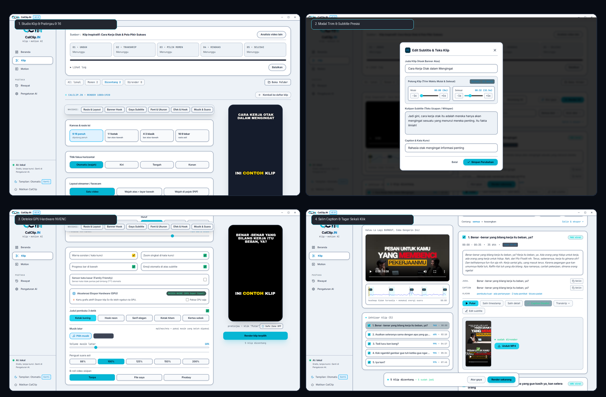
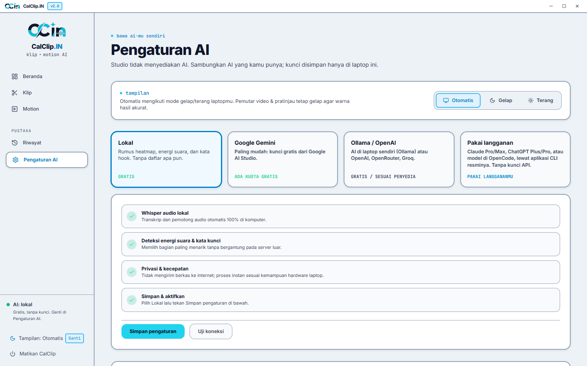

<p align="center">
  
</p>

<h1 align="center">CalClip.IN</h1>

<p align="center">
  <b>Aplikasi Otomasi Pemotong Video Vertikal 9:16 dan Generator Motion AI</b><br>
  <i>Berjalan Mandiri di Komputer Lokal &bull; Akselerasi Hardware GPU &bull; Privasi Terjaga &bull; Open Source</i>
</p>

<p align="center">
  <a href="https://github.com/IkhsanFreya/calclip/releases/latest"></a>
  
  
  
</p>

---

## Tentang CalClip.IN

CalClip.IN adalah aplikasi desktop open-source yang dirancang untuk mengotomasi alur kerja pengolahan konten video panjang menjadi klip vertikal format 9:16 (TikTok, Instagram Reels, YouTube Shorts). Aplikasi ini juga dilengkapi generator Motion AI untuk memproduksi video penjelasan berbasis naskah dan suara narator otomatis.

Seluruh proses transkripsi, deteksi wajah, dan rendering video berjalan secara lokal di komputer pengguna tanpa ketergantungan pada layanan cloud berbayar.

---

## Pratinjau Antarmuka

<p align="center">
  
</p>

<details>
<summary><b>Klik di sini untuk melihat tangkapan layar per fitur secara terpisah</b></summary>
<br>

| 1. Studio Editor Klip 9:16 | 2. Modal Trim & Subtitle |
| :---: | :---: |
|  |  |

| 3. Salin Caption & Tagar | 4. Deteksi Akselerasi GPU |
| :---: | :---: |
|  |  |

<p align="center">
  <b>5. Pengaturan Model AI Terintegrasi</b><br>
  
</p>

</details>

---

## Fitur Utama

### 1. Deteksi Momen dan Pemotongan Otomatis
- **Analisis Gelombang Suara dan Retensi:** Memindai bagian video dengan dinamika bicara tertinggi dan pola interaksi penonton.
- **Dukungan Model AI Fleksibel:**
  - **Lokal Heuristik:** Eksekusi bebas internet tanpa API key.
  - **Google Gemini:** Integrasi Google AI Studio (`gemini-2.5-flash`, `gemini-3.1-flash-lite`).
  - **Model Lokal & Eksternal:** Mendukung Ollama, OpenAI, Claude CLI, dan Groq.

### 2. Preset Subtitle Kinetik
- **Pilihan Tipografi Terstruktur:** Alex Hormozi (boks teks kontras tinggi), MrBeast (tipografi tegas dengan animasi sorot), Ali Abdaal (minimalis editorial), dan TikTok Neon.
- **Penyaring Kata (Family Friendly):** Deteksi dan penyensoran otomatis kata-kata tidak pantas pada subtitle dan hook banner menjadi representasi asterisk (`***`).

### 3. Timeline Mini Trim Presisi
- Kontrol slider penyesuaian detik awal dan akhir video dengan penambahan/pengurangan cepat (-1s / +1s).
- Kalkulasi durasi otomatis dan sinkronisasi pratinjau kanvas secara langsung.

### 4. Akselerasi Perangkat Keras GPU
- **Dukungan Hardware Encoder:** NVIDIA NVENC, Intel QuickSync Video (QSV), dan AMD AMF untuk peningkatan performa ekspor video hingga 5x–8x lebih efisien.
- **CPU Fallback Otomatis:** Deteksi cerdas yang mengalihkan proses ke encoder CPU (`libx264`) secara aman jika GPU dedicated tidak terpasang.

### 5. Generator Deskripsi dan Tagar
- Ekstraksi judul, kutipan pokok, serta pembuatan kumpulan tagar relevan dalam satu klik untuk mempermudah distribusi konten ke platform media sosial.

### 6. Keamanan dan Isolasi Data
- **Loopback Isolation:** Layanan backend terikat eksklusif pada interface loopback (`127.0.0.1`), mencegah akses tidak sah melalui jaringan LAN/Wi-Fi.
- **Proteksi Rebinding & CSRF:** Validasi ketat pada Host Header serta penolakan permintaan lintas domain.
- **Penyimpanan Terisolasi:** Berkas proyek, konfigurasi, dan riwayat video disimpan di direktori pengguna (`%USERPROFILE%\CalClip`), memastikan data tetap utuh saat aplikasi diperbarui.

---

## Panduan Instalasi (Windows)

### Pemasangan Menggunakan Installer Mandiri
1. Unduh berkas resmi pada halaman **[Releases](https://github.com/IkhsanFreya/calclip/releases/latest)**:
   - **`CalClip-v2.0-Windows-Setup.exe`** (148.51 MB — Wizard Installer Otomatis)
   - **`CalClip-v2.0-Windows-Setup.zip`** (148.51 MB — Arsip ZIP Resmi)
2. Jalankan berkas installer (tidak membutuhkan hak akses Administrator / UAC).
3. Ikuti instruksi pada wizard instalasi. Aplikasi akan otomatis terpasang dengan pintasan di Desktop dan Start Menu.

### Eksekusi dari Kode Sumber (Development Mode)
Pastikan sistem telah terpasang **Node.js (v18+)** dan **Python (3.10+)**:

```bash
# Clone repositori
git clone https://github.com/IkhsanFreya/calclip.git
cd calclip

# Pasang dependensi frontend
npm install

# Jalankan aplikasi
jalankan-calclip.bat
```

Antarmuka aplikasi dapat diakses melalui browser pada alamat:
`http://localhost:8799/`

---

## Mekanisme Pembaruan

1. Buka menu **Pengaturan AI** pada antarmuka aplikasi, kemudian pilih **Periksa Pembaruan Aplikasi**.
2. Apabila versi baru tersedia, unduh installer terbaru melalui tautan yang disediakan.
3. Jalankan installer baru untuk memperbarui aplikasi.
4. Seluruh berkas video, data proyek, dan konfigurasi pengguna tersimpan aman di direktori `%USERPROFILE%\CalClip` dan tidak akan terhapus selama proses pembaruan.

---

## Tumpukan Teknologi

- **Frontend:** React 18, TypeScript, Tailwind CSS, Lucide Icons, Vite
- **Backend & Servis:** Python 3 (ThreadingHTTPServer mandiri, port 8799)
- **AI & Transkripsi:** faster-whisper (CTranslate2), Google GenAI SDK, OpenCV (YuNet Face Detection)
- **Pemrosesan Video:** FFmpeg (Hardware NVENC/QSV/AMF & CPU libx264)
- **Motion Engine:** Remotion, Edge-TTS, Kokoro TTS
- **Distribusi & Packaging:** Inno Setup Compiler 6 (LZMA2 Ultra Compression), Native C# Launcher (`CalClip.exe`)

---

## Lisensi

Proyek ini dilisensikan di bawah **MIT License**. Hak cipta dan izin penggunaan terbuka, Terimakasih ENJOY
.
