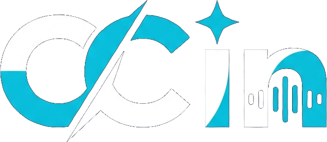
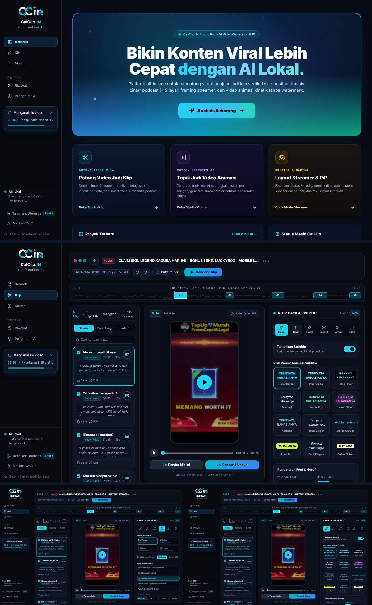
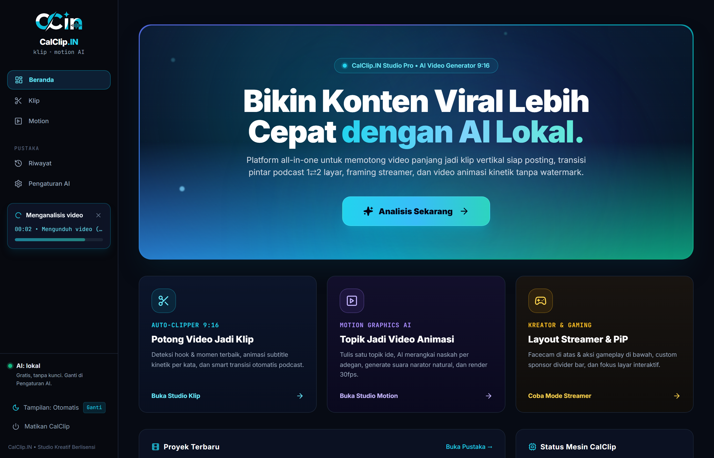
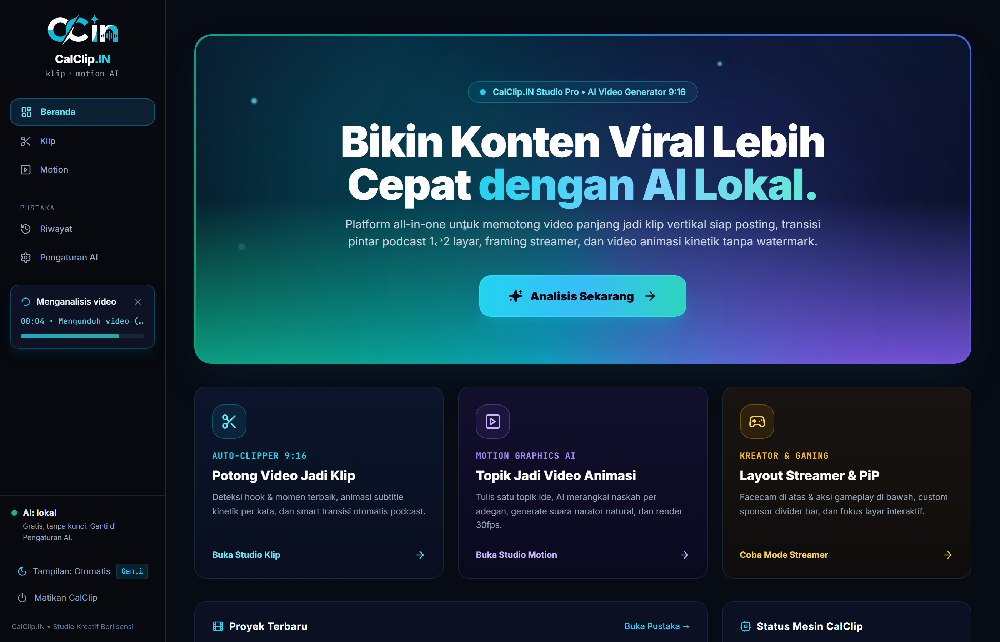
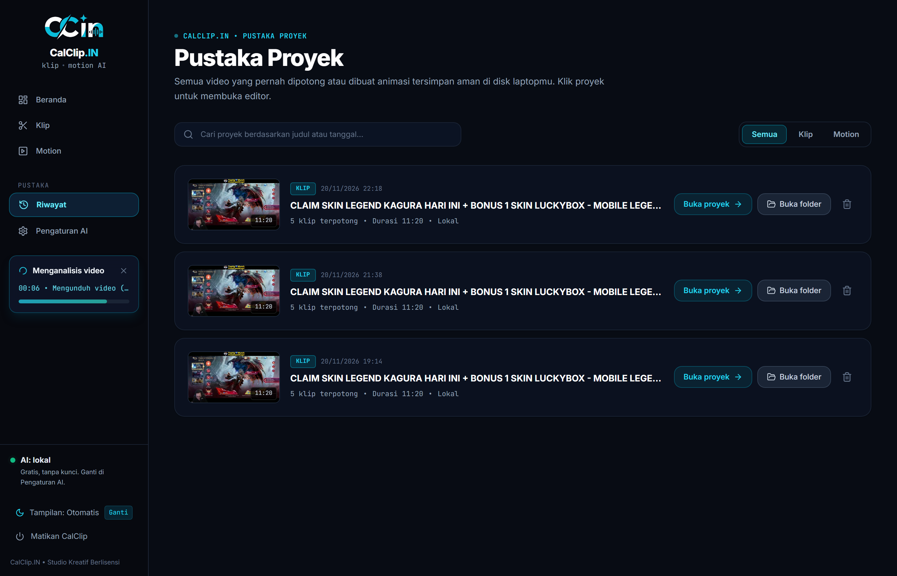
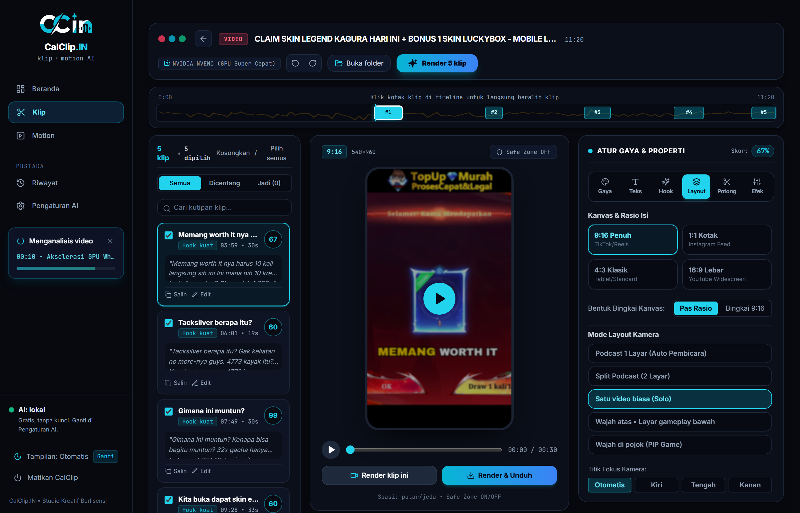
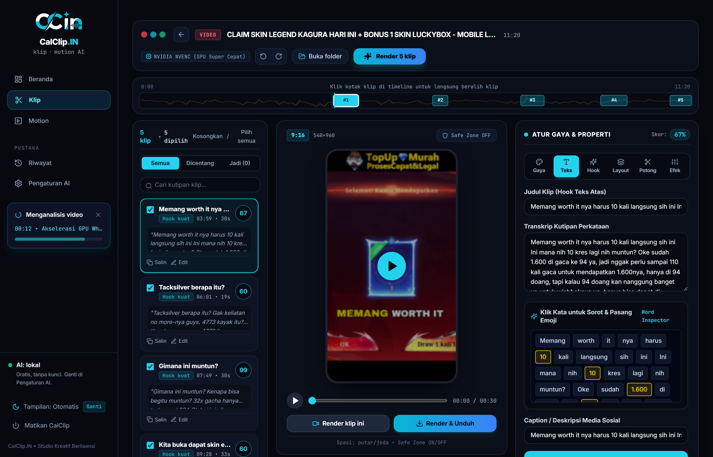
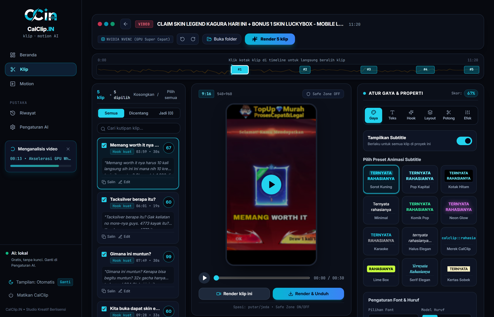

<p align="center">
  
</p>

<h1 align="center">CalClip.IN</h1>

<p align="center">
  <b>Aplikasi Otomasi Pemotong Video Vertikal 9:16 dan Generator Motion AI</b><br>
  <i>Berjalan Mandiri di Komputer Lokal &bull; Akselerasi Hardware GPU &bull; Privasi Terjaga &bull; Open Source</i>
</p>

<p align="center">
  <a href="https://github.com/IkhsanFreya/calclip/releases/latest"></a>
  
  
  
</p>

---

## Tentang CalClip.IN

CalClip.IN adalah aplikasi desktop open-source yang dirancang untuk mengotomasi alur kerja pengolahan konten video panjang menjadi klip vertikal format 9:16 (TikTok, Instagram Reels, YouTube Shorts). Aplikasi ini juga dilengkapi generator Motion AI untuk memproduksi video penjelasan berbasis naskah dan suara narator otomatis.

Seluruh proses transkripsi, deteksi wajah, dan rendering video berjalan secara lokal di komputer pengguna tanpa ketergantungan pada layanan cloud berbayar.

---

## Pratinjau Antarmuka (Dark Mode)

<p align="center">
  
</p>

<details>
<summary><b>Klik di sini untuk melihat tangkapan layar per fitur secara terpisah</b></summary>
<br>

| 1. Beranda — Dashboard Utama | 2. Studio Klip — Input & Analisis Video |
| :---: | :---: |
|  |  |

| 3. Editor Klip — Timeline, Pratinjau & Daftar Klip | 4. Pustaka Proyek — Riwayat Video |
| :---: | :---: |
|  |  |

| 5. Layout Kamera — Mode Streamer & Facecam | 6. Teks — Word Inspector & Hook Editor |
| :---: | :---: |
|  |  |

<p align="center">
  <b>7. Preset Animasi Subtitle</b><br>
  
</p>

</details>

---

## Fitur Utama

### 1. Deteksi Momen dan Pemotongan Otomatis
- **Analisis Gelombang Suara dan Retensi:** Memindai bagian video dengan dinamika bicara tertinggi dan pola interaksi penonton.
- **Dukungan Model AI Fleksibel:**
  - **Lokal Heuristik:** Eksekusi bebas internet tanpa API key.
  - **Google Gemini:** Integrasi Google AI Studio (`gemini-2.5-flash`, `gemini-3.1-flash-lite`).
  - **Model Lokal & Eksternal:** Mendukung Ollama, OpenAI, Claude CLI, dan Groq.

### 2. Subtitle Kinetik Dinamis (Word-by-Word)
- **Sinkronisasi Per Kata:** Subtitle tampil kata per kata secara real-time menggunakan timestamp dari Whisper AI, memberikan efek "karaoke" yang menarik perhatian penonton.
- **10+ Preset Animasi:** Sorot Kuning, Pop Kapital, Kotak Hitam, Neon Glow, Komik Pop, Karaoke, Minimal, Halus Elegan, Lime Box, Serif Elegan, Kertas Sobek, dan Merek CalClip.
- **Word Inspector:** Klik kata individual untuk menyorot atau menambahkan emoji secara presisi.
- **Penyaring Kata (Family Friendly):** Deteksi dan penyensoran otomatis kata-kata tidak pantas pada subtitle menjadi representasi asterisk (`***`).

### 3. Smart Facecam Framing (Zoom Hingga 5.0x)
- **YuNet ONNX Face Tracker:** Pelacakan posisi wajah subjek secara real-time pada setiap adegan video.
- **Filter Kalman Linear 2D:** Meredam getaran kamera (camera jitter) hingga >95% sehingga transisi framing 9:16 tetap halus, tenang, dan stabil.
- **Deadzone Hysteresis:** Mencegah goyangan pembingkaian saat subjek melakukan pergerakan kepala kecil.
- **5 Mode Layout Kamera:**
  - Podcast 1 Layar (Auto Pembicara)
  - Split Podcast (2 Layar)
  - Satu Video Biasa (Solo)
  - Wajah Atas + Layar Gameplay Bawah
  - Wajah di Pojok (PiP Game)
- **Preset Sudut Cepat:** Kiri Bawah, Kanan Bawah, Kiri Atas, Kanan Atas, Tengah — satu klik langsung set posisi facecam.

### 4. Timeline Mini Trim Presisi
- Kontrol slider penyesuaian detik awal dan akhir video dengan penambahan/pengurangan cepat (-1s / +1s).
- Kalkulasi durasi otomatis dan sinkronisasi pratinjau kanvas secara langsung.

### 5. Akselerasi Perangkat Keras GPU
- **Dukungan Hardware Encoder:** NVIDIA NVENC, Intel QuickSync Video (QSV), dan AMD AMF untuk peningkatan performa ekspor video hingga 5x–8x lebih efisien.
- **CPU Fallback Otomatis:** Deteksi cerdas yang mengalihkan proses ke encoder CPU (`libx264`) secara aman jika GPU dedicated tidak terpasang.
- **Render Klip Satuan:** Render satu klip spesifik tanpa harus menunggu seluruh batch selesai.

### 6. Studio-Grade Audio Mastering & Voice Denoising
- **Broadcast Loudness Normalization (EBU R128):** Normalisasi volume audio vokal target $-14\text{ LUFS}$ dengan True Peak $-1.0\text{ dBTP}$ (standar resmi TikTok, Instagram Reels, dan YouTube Shorts) agar suara terdengar lantang, tebal, dan bebas distorsi di speaker smartphone.
- **AI Speech Denoise (Adaptive FFT):** Pembersih derau otomatis yang meredam suara kipas laptop, desis kelistrikan mic (>12 kHz), serta gemuruh angin (<80 Hz).
- **Anti-Click Boundary Micro-Fade:** Pemotongan klip cerdas dengan transisi micro-fade di awal dan akhir batas waktu untuk menghilangkan letupan audio (*pop/click*).
- **Auto Audio Ducking:** Pengecilan volume musik latar secara otomatis saat pembicara bersuara dan kembali normal pada jeda hening.

### 7. Generator Motion AI (Video Animasi dari Topik)
- **Naskah Otomatis:** Tulis satu topik ide, AI merangkai naskah per adegan lengkap dengan narasi.
- **Suara Narator Natural:** Integrasi Edge-TTS dan Kokoro TTS untuk suara narator berkualitas tinggi.
- **Render Video 30fps:** Menggunakan Remotion engine untuk menghasilkan video animasi siap posting.

### 8. Generator Deskripsi dan Tagar
- Ekstraksi judul, kutipan pokok, serta pembuatan kumpulan tagar relevan dalam satu klik untuk mempermudah distribusi konten ke platform media sosial.

### 9. Keamanan dan Isolasi Data
- **Loopback Isolation:** Layanan backend terikat eksklusif pada interface loopback (`127.0.0.1`), mencegah akses tidak sah melalui jaringan LAN/Wi-Fi.
- **Proteksi Rebinding & CSRF:** Validasi ketat pada Host Header serta penolakan permintaan lintas domain.
- **Penyimpanan Terisolasi:** Berkas proyek, konfigurasi, dan riwayat video disimpan di direktori pengguna (`%USERPROFILE%\CalClip`), memastikan data tetap utuh saat aplikasi diperbarui.
- **100% Offline-First:** Tidak memerlukan koneksi internet untuk fungsi inti (transkripsi, deteksi wajah, rendering). Internet hanya diperlukan saat mengunduh video YouTube atau menggunakan model AI cloud (Gemini/Ollama).

---

## Panduan Instalasi (Windows)

### Pemasangan Menggunakan Installer Mandiri
1. Unduh berkas resmi pada halaman **[Releases](https://github.com/IkhsanFreya/calclip/releases/latest)**:
   - **`CalClip-v2.1-Windows-Setup.exe`** (~181 MB — Wizard Installer Otomatis)
   - **`CalClip-v2.1-Windows-Setup.zip`** (~181 MB — Arsip ZIP Resmi)
2. Jalankan berkas installer (tidak membutuhkan hak akses Administrator / UAC).
3. Ikuti instruksi pada wizard instalasi. Aplikasi akan otomatis terpasang dengan pintasan di Desktop dan Start Menu.

> [!TIP]
> **Pemberitahuan Windows SmartScreen (Penerbit Tidak Dikenal):**  
> Karena CalClip.IN merupakan aplikasi *open-source* independen yang tidak menyertakan sertifikat digital EV berbayar dari Microsoft ($400/tahun), Windows Defender SmartScreen mungkin menampilkan dialog proteksi:  
> *"Windows protected your PC"* atau *"Windows melindungi PC Anda"*.  
>
> **Langkah melanjutkan:**  
> 1. Klik tautan **"More info"** / **"Info selengkapnya"**  
> 2. Klik tombol **"Run anyway"** / **"Tetap jalankan"**  
>
> Seluruh kode sumber CalClip.IN 100% terbuka (*open source*), bebas dari *malware* maupun pelacak pihak ketiga, dan seluruh pemrosesan AI berjalan secara lokal di komputer Anda.

### Eksekusi dari Kode Sumber (Development Mode)
Pastikan sistem telah terpasang **Node.js (v18+)** dan **Python (3.10+)**:

```bash
# Clone repositori
git clone https://github.com/IkhsanFreya/calclip.git
cd calclip

# Pasang dependensi frontend
npm install

# Jalankan aplikasi
jalankan-calclip.bat
```

Antarmuka aplikasi dapat diakses melalui browser pada alamat:
`http://localhost:8799/`

---

## Mekanisme Pembaruan

1. Buka menu **Pengaturan AI** pada antarmuka aplikasi, kemudian pilih **Periksa Pembaruan Aplikasi**.
2. Apabila versi baru tersedia, unduh installer terbaru melalui tautan yang disediakan.
3. Jalankan installer baru untuk memperbarui aplikasi.
4. Seluruh berkas video, data proyek, dan konfigurasi pengguna tersimpan aman di direktori `%USERPROFILE%\CalClip` dan tidak akan terhapus selama proses pembaruan.

---

## Tumpukan Teknologi

- **Frontend:** React 18, TypeScript, Tailwind CSS, Lucide Icons, Vite
- **Backend & Servis:** Python 3 (ThreadingHTTPServer mandiri, port 8799)
- **AI & Transkripsi:** faster-whisper (CTranslate2 INT8), Google GenAI SDK, OpenCV (YuNet ONNX Face Detection), Filter Kalman Linear 2D
- **Pemrosesan Video:** FFmpeg (Hardware NVENC/QSV/AMF & CPU libx264), yt-dlp
- **Motion Engine:** Remotion, Edge-TTS, Kokoro TTS
- **Distribusi & Packaging:** Inno Setup Compiler 6 (LZMA2 Ultra Compression), Native C# Launcher (`CalClip.exe`)

---

## Riwayat Versi

### v2.1.0 — Dynamic Subtitles, Facecam Smart Framing & AI Motion Suite
- Subtitle kinetik word-by-word dengan timestamp Whisper AI
- Smart facecam framing dengan zoom hingga 5.0x dan Filter Kalman Linear 2D
- Broadcast Audio Loudness Normalization EBU R128 (-14 LUFS) & AI Speech Denoise (FFT)
- Anti-click boundary micro-fade & auto audio ducking BGM
- 10+ preset animasi subtitle baru
- Word Inspector untuk highlight dan emoji per kata
- Render klip satuan (satu per satu)
- Mode layout streamer lengkap (Solo, Podcast, Split, PiP)
- Generator Motion AI dengan naskah dan suara narator otomatis

### v2.0.0 — Production Release
- Rilis produksi pertama dengan installer Windows mandiri
- Deteksi momen otomatis (Lokal, Gemini, Ollama, OpenAI)
- Transkripsi Whisper AI dengan prompt conditioning Bahasa Indonesia
- Akselerasi GPU (NVENC, QSV, AMF) dengan CPU fallback
- Keamanan loopback isolation dan proteksi CSRF
- Preset gaya influencer (Alex Hormozi, MrBeast, Ali Abdaal, TikTok Neon)

---

## Lisensi

Proyek ini dilisensikan di bawah **MIT License**. Hak cipta dan izin penggunaan terbuka, Terimakasih ENJOY
