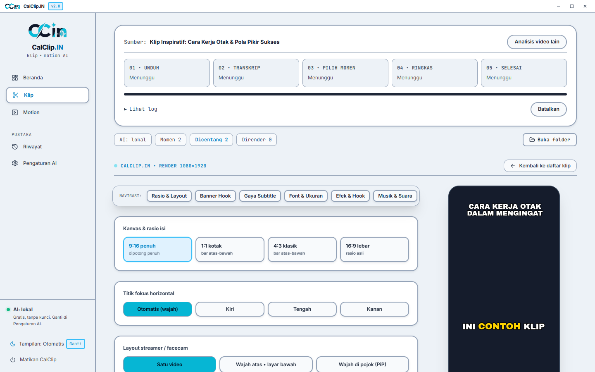
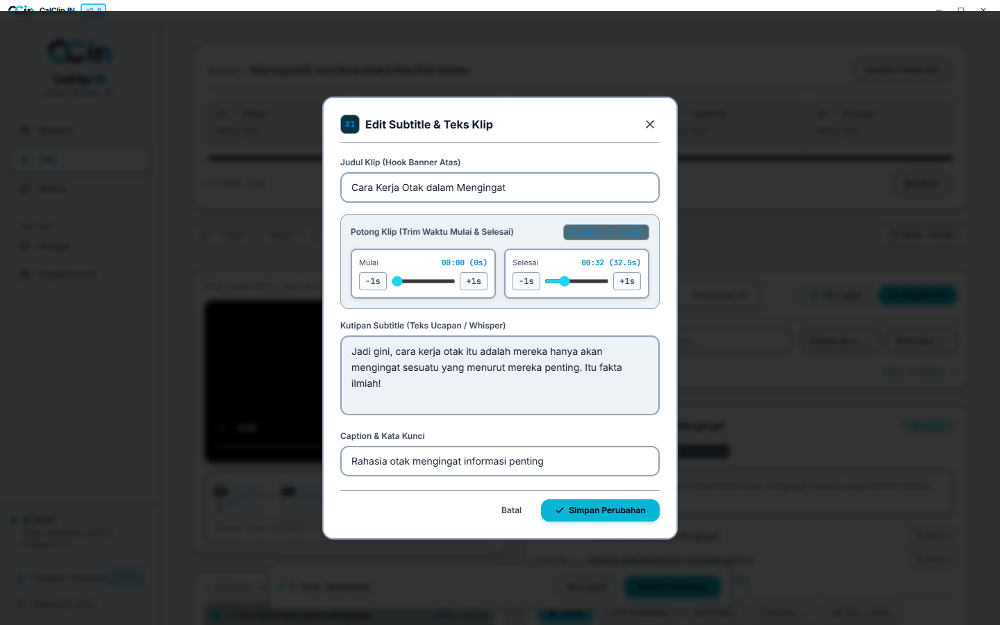
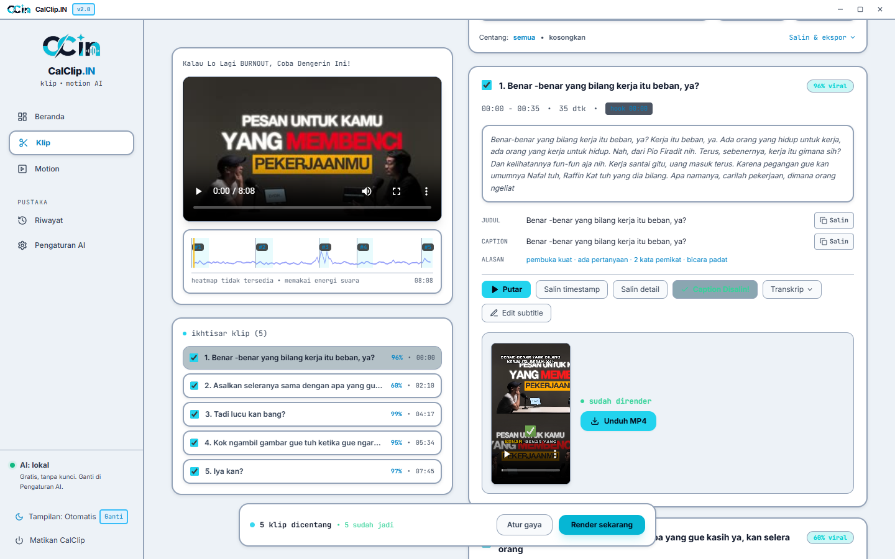
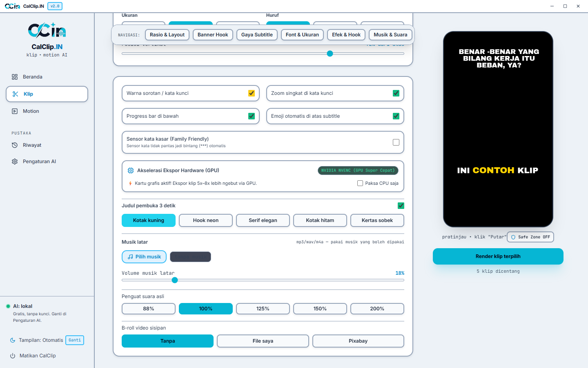

<p align="center">
  
</p>

<h1 align="center">CalClip.IN v2.0</h1>

<p align="center">
  <b>Potong Video Panjang Jadi Klip Siap Viral 9:16 & Generator Motion AI Otomatis</b><br>
  <i>100% Gratis • Berjalan Mandiri di Laptopmu • Privasi Terjaga • Tanpa Langganan Berbayar</i>
</p>

<p align="center">
  <a href="https://github.com/IkhsanFreya/calclip/releases/latest"></a>
  
  
  
</p>

---

## 🌟 Tentang CalClip.IN

**CalClip.IN** adalah aplikasi desktop modern open-source untuk para kreator konten, podcaster, streamer, dan pendidik. CalClip mampu mendeteksi bagian paling menarik dan viral dari video panjang YouTube atau berkas video lokal, memotongnya secara presisi menjadi format vertikal 9:16 (TikTok, Reels, Shorts), menambahkan subtitle kinetik beranimasi, hook banner pemikat, serta membuat video animasi penjelasan otomatis dengan suara narasi AI.

Semua proses transkripsi dan pemotongan dapat berjalan **100% lokal di komputermu tanpa memotong kuota cloud** ataupun dengan menghubungkan AI favoritmu (Google Gemini, OpenAI, Claude Code, Ollama).

---

## 📸 Tangkapan Layar (Preview Antarmuka)

<p align="center">
  <b>1. Studio Editor Klip & Pratinjau Kanvas 9:16 Real-Time</b><br>
  
</p>

<p align="center">
  <b>2. Modal Edit Subtitle & Timeline Mini Trim Slider (-1s / +1s)</b><br>
  
</p>

<p align="center">
  <b>3. 1-Klik Salin Caption & Hashtag Viral Siap Upload (TikTok/Reels)</b><br>
  
</p>

<p align="center">
  <b>4. Deteksi Otomatis Akselerasi GPU Hardware (NVIDIA NVENC / Intel QSV / CPU Fallback)</b><br>
  
</p>

<p align="center">
  <b>5. Pengaturan Model AI & Pengecek Pembaruan Terintegrasi</b><br>
  
</p>

---

## ✨ Fitur-Fitur Unggulan

### 1. 🎬 Auto Clipper Pintar (Deteksi Momen Viral)
- **Analisis Gelombang Suara & Retensi:** Memindai bagian video dengan energi bicara tertinggi dan heatmap tontonan.
- **Pilihan Mesin AI Fleksibel:**
  - **Lokal Heuristik:** 100% gratis tanpa internet dan tanpa kunci API.
  - **Google Gemini:** Kuota gratis dari Google AI Studio (`gemini-2.5-flash`, `gemini-3.1-flash-lite`).
  - **Langganan Resmi:** Dukungan Claude Code (Claude Pro/Max) & Codex (ChatGPT Plus/Pro) lewat terminal CLI.
  - **Ollama / OpenAI / Groq:** Jalankan model lokal Llama / DeepSeek di komputermu sendiri.

### 2. 🎨 Preset Subtitle Influencer 1-Klik
Terapkan gaya subtitle kinetik khas kreator papan atas hanya dengan sekali klik:
- 🟡 **Alex Hormozi:** Kotak hitam tebal + teks kuning dengan sorot kata aktif.
- 🔴 **MrBeast:** Huruf kapital tebal dengan efek *pop-zoom* memantul dan kata kunci berwarna.
- ⚪ **Ali Abdaal:** Gaya elegan, minimalis, dan kalem cocok untuk konten edukasi/produktivitas.
- 💖 **TikTok Neon:** Huruf pop neon warna-warni kontras tinggi untuk menarik perhatian gen-Z.
- **Sensor Kata Kasar (Family Friendly):** Otomatis menyensor kata-kata tidak pantas di subtitle & banner menjadi `***`.

### 3. ✂️ Mini Trim Slider Presisi
- Tombol cepat **[-1s]** dan **[+1s]** serta slider waktu mulai dan selesai di setiap klip.
- Kalkulasi durasi otomatis secara *live*.

### 4. ⚡ Akselerasi Hardware Super Cepat (GPU Auto-Fallback)
- **NVIDIA NVENC:** Ekspor video selesai dalam 8–15 detik (5x–8x lebih cepat).
- **Intel QuickSync (QSV) & AMD AMF:** Akselerasi kartu grafis terintegrasi laptop.
- **Auto CPU Fallback (`libx264`):** Jika laptop tidak memiliki GPU, aplikasi otomatis menggunakan CPU biasa tanpa crash.

### 5. 📱 1-Klik Salin Caption & Hashtag Viral
- Sekali klik, langsung meracik judul, kutipan klip, dan 5–8 hashtag viral yang relevan (`#fyp #shorts #reels`). Siap langsung ditempel di kolom deskripsi TikTok/Instagram.

### 6. 🔒 Keamanan Maksimal (Anti-Crack & Anti-Hacker)
- **Loopback Only Isolation:** Backend hanya mendengarkan `127.0.0.1`, kebal terhadap akses jaringan publik Wi-Fi/LAN.
- **Anti-DNS Rebinding & Anti-CSRF:** Memvalidasi Host Header dan menolak permintaan POST dari domain luar.
- **Path Traversal Defense:** Mengunci akses direktori sistem operasi.
- **Penyimpanan Data Terisolasi:** Proyek dan kunci API disimpan aman di `%USERPROFILE%\CalClip`, aman dan tidak akan terhapus saat aplikasi diperbarui.

---

## 📥 Panduan Instalasi (Windows)

### Cara 1: Menggunakan Installer .EXE (Paling Praktis)
1. Buka tab **[Releases](https://github.com/IkhsanFreya/calclip/releases/latest)**.
2. Unduh berkas installer: **`CalClip-v2.0-Windows-Setup.exe`**.
3. Jalankan file `.exe` tersebut (tidak memerlukan hak akses Administrator/UAC).
4. Klik **Next** sampai selesai. CalClip.IN akan langsung terpasang dan membuat ikon shortcut di Desktop & Start Menu.

### Cara 2: Menjalankan dari Kode Sumber (Mode Pengembang)
Pastikan kamu memiliki **Node.js (v18+)** dan **Python (3.10+)**:

```bash
# 1. Clone repository ini
git clone https://github.com/IkhsanFreya/calclip.git
cd calclip

# 2. Pasang dependensi frontend
npm install

# 3. Jalankan aplikasi sekali klik
jalankan-calclip.bat
```

Aplikasi akan otomatis membuka browser di:
`http://localhost:8799/`

---

## 🔄 Bagaimana Cara Melakukan Update?

Saat ada pembaruan versi baru:
1. Buka menu **Pengaturan AI** di dalam aplikasi, klik **"Periksa Pembaruan Aplikasi"**.
2. Jika ada versi baru, klik tombol unduh installer versi terbaru.
3. Jalankan installer baru tersebut. Installer akan otomatis menimpa file program lama.
4. **Semua data video, riwayat, dan kunci API kamu 100% aman dan tidak akan hilang**, karena tersimpan di folder pengguna `C:\Users\<Kamu>\CalClip`.

---

## 🛠️ Tumpukan Teknologi (Tech Stack)

- **Frontend:** React 18, TypeScript, Tailwind CSS, Lucide Icons, Vite
- **Backend & Server:** Python 3 (ThreadingHTTPServer mandiri pada port 8799)
- **AI & Transkripsi:** faster-whisper (CTranslate2), Google GenAI SDK, OpenCV (YuNet Face Detection)
- **Video Rendering:** FFmpeg (Hardware NVENC/QSV/AMF & CPU libx264)
- **Motion Engine:** Remotion, Edge-TTS, Kokoro TTS
- **Packaging:** Inno Setup Compiler 6 (Ultra LZMA2 Solid Compression)

---

## 📄 Lisensi

Proyek ini dilisensikan di bawah lisensi **MIT License** — bebas digunakan, dimodifikasi, dan didistribusikan untuk keperluan pribadi maupun komersial.

---

<p align="center">
  Dibuat dengan ❤️ untuk seluruh kreator konten Indonesia oleh <b><a href="https://github.com/IkhsanFreya">IkhsanFreya</a></b>.
</p>
